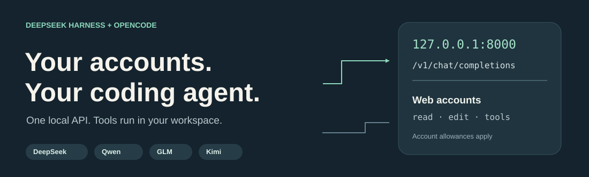
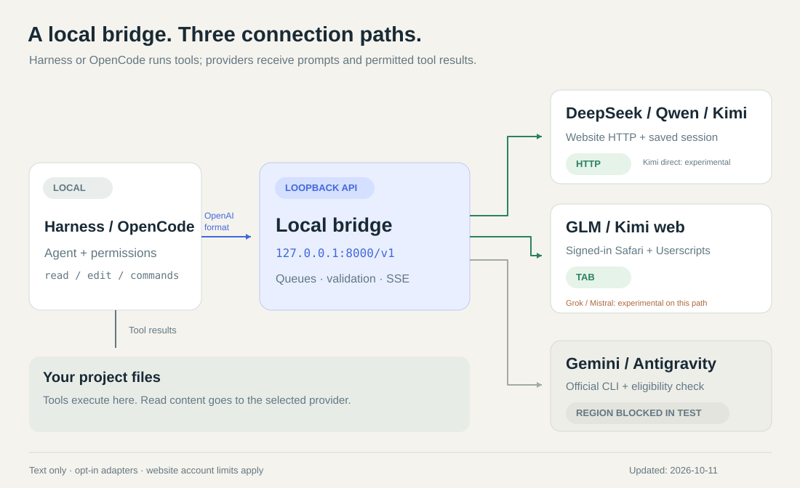
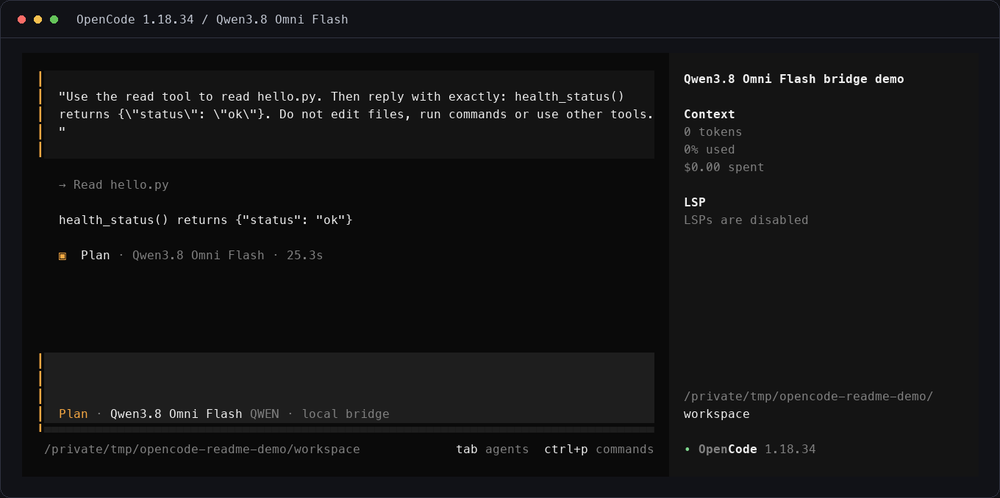
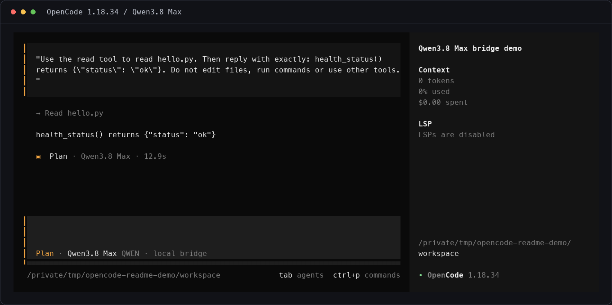

<p align="center">
  
</p>

<p align="center">
  <a href="README.en.md">English</a> ·
  <a href="#быстрый-старт">Установка</a> ·
  <a href="#подключение-harness">Harness</a> ·
  <a href="#подключение-opencode">OpenCode</a> ·
  <a href="#что-работает">Провайдеры</a> ·
  <a href="docs/HARNESS.ru.md">Справка Harness</a>
</p>

# Ваши AI-аккаунты — в DeepSeek Harness и OpenCode

Один локальный сервер соединяет **DeepSeek Harness или OpenCode** с вашими
аккаунтами DeepSeek, Qwen, Kimi и GLM. Клиент работает с проектом и выполняет
инструменты, мост передаёт сообщения через OpenAI-совместимый API.
Для веб-подключений отдельный API-ключ провайдера не нужен.

**Harness работает самостоятельно: устанавливать OpenCode для него не нужно.**
Всё описанное здесь находится в `main` этого форка.

**Обновление безопасности от 12 октября 2026:** локальный `/v1` теперь требует
токен моста. После обновления перенастройте клиент по разделу
[Токен доступа к API](#токен-доступа-к-api). Исправления привязки аккаунта,
защиты от повторов, shell-команд и завершения CLI проверены офлайн; это обновление
не проверялось на живых аккаунтах в Harness, OpenCode или браузере.

[](https://github.com/DmitrL-dev/opencode-deepseek/actions/workflows/tests.yml)

> Это не безлимитный API. Действуют квоты аккаунта и локальные ограничения моста.
> Автоматизация веб-чата может привести к блокировке: на нашем аккаунте DeepSeek
> ограничения возникали повторно, точная причина не установлена. Успешный тест
> не гарантирует доступность следующей задачи. [Защита аккаунтов](docs/ACCOUNT_SAFETY.md).

## Быстрый старт

Понадобятся **Python 3.9+** (рекомендуется 3.12), Git, аккаунт выбранного сервиса
и один клиент: [DeepSeek Harness](https://www.deepseek.com/en/harness/) или
[OpenCode](https://opencode.ai/docs/). Ниже — macOS/Linux;
[Windows и подробная настройка](docs/SETUP.ru.md).

### 1. Установите мост

```bash
git clone https://github.com/DmitrL-dev/opencode-deepseek.git
cd opencode-deepseek
python3 -m venv venv
source venv/bin/activate
python -m pip install -r requirements.txt
python -m playwright install chromium
cp .env.example .env
```

При обновлении существующей установки сохраняйте свой `.env` и `session/`.
Все провайдеры в примере выключены; включайте только нужные.

### 2. Подключите аккаунт

Для первого запуска ниже используется **Qwen Flash**:

```bash
python -m qwen.auth
```

Войдите сами в открытом окне, дождитесь сохранения сессии. В `.env` измените:

```dotenv
QWEN_ENABLED=1
```

Первоначальный вход требует браузера, дальнейшие запросы Qwen работают без
вкладок. Токен короткоживущий: для продления перед новым запросом можно отдельно
включить `QWEN_RENEW_SESSION=1`. Продление выполняется внутри durable-попытки
этого запроса и должно вернуть тот же аккаунт. Ссылки бесед привязаны к аккаунту
Qwen, поэтому смена токена не обрывает цели Harness. Когда истечёт cookie входа,
снова потребуется ручной вход. [Как устроено продление](docs/HARNESS.ru.md#сессия-qwen).

**Нужен DeepSeek вместо Qwen?** Выполните `python -m deepseek.auth`, войдите в
аккаунт и задайте `DEEPSEEK_ENABLED=1`. В команде установки Harness ниже замените
`qwen3.8-omni-flash` на `deepseek-chat` или `deepseek-expert`. Автоматического
продления DeepSeek нет; сохранённая сессия используется независимо от возраста.
При отказе токена (`40002`/`40003`) запросы останавливаются без повторов; нужен ручной вход. Новый захват `python -m deepseek.auth` сохраняет историю Harness только для того же подтверждённого аккаунта; другой аккаунт отклоняется (осознанная замена — `--replace-account`), а для неподтверждённой прежней сессии нужен `--same-account`. Не продолжайте запросы при предупреждении об ограничении аккаунта.

Для Kimi используйте [отдельную настройку HTTP-сессии](docs/KIMI.md),
для GLM — [подключение вкладки Safari](browser/README.md#safari).

### 3. Запустите сервер

```bash
python app.py
```

Оставьте этот терминал открытым. Один процесс обслуживает все включённые
подключения; второй экземпляр не нужен. В другом терминале:

```bash
curl http://127.0.0.1:8000/healthz
curl -H "Authorization: Bearer $(cat "$(python -m server.api_auth path)")" http://127.0.0.1:8000/v1/models
```

Эти проверки локальные и не отправляют запросы моделям. Каждый запрос к `/v1`
требует токен API моста (см. [Токен доступа к API](#токен-доступа-к-api)). В каталоге должна
появиться выбранная модель. Затем подключите **свой клиент** ниже.

## Токен доступа к API

API `/v1` управляет вашими аккаунтами провайдеров, поэтому требует
`Authorization: Bearer <токен>` и локальный `Host`. Сервер при первом
обращении создаёт приватный файл `session/api-token` (`0600`);
`python -m server.api_auth path` печатает путь к нему, но не сам токен. Запросы
без токена, со страниц браузера (cross-site или DNS rebinding) и на чужой Host
отклоняются до обращения к провайдеру и к rate-limit.

Миграция с бесключевого API:

1. Обновите мост и перезапустите его.
2. Harness: повторите `python -m integrations.harness --install <профиль> ...` с
   прежними параметрами. Заголовок `Bearer unused` заменится токеном в
   приватном файле профиля. Перезапустите Harness.
3. OpenCode: укажите `"apiKey": "{file:/абсолютный/путь/session/api-token}"` для
   каждого локального провайдера ([пример](examples/opencode.json)). Прочие
   клиенты OpenAI SDK передают токен как `api_key`.
4. Только на время миграции `API_AUTH=legacy-loopback` пропускает запросы без
   токена от loopback-клиента с loopback Host и без заголовков браузера. Уберите
   настройку, когда клиенты начнут передавать токен.

`HOST` вне loopback отклоняется без `API_ALLOW_PUBLIC_BIND=1` (только в режиме
токена). Тогда также перечислите обслуживаемые имена в `API_ALLOWED_HOSTS` и
закройте порт межсетевым экраном. Эта проверка адреса есть только в `python app.py`:
прямой запуск `uvicorn server.api:app --host …` её обходит, хотя Host и токен
(кроме переходного `legacy-loopback`) по-прежнему проверяются для каждого `/v1`.

## Подключение Harness

1. Установите и один раз откройте [официальный Harness](https://www.deepseek.com/en/harness/).
   При начальной настройке можно выбрать **Add API Key → Set up later**.
2. В другом терминале перейдите в каталог моста, активируйте `source venv/bin/activate`
   и выполните при работающем сервере:

```bash
python -m integrations.harness --install desktop --without-browser --default-model qwen3.8-omni-flash
python -m integrations.harness_shell_safety --profile desktop
```

3. В Harness выберите **папку проекта**, создайте **новую сессию** и в меню моделей
   выберите группу **Local account bridge** → нужную модель. Если группа ещё не
   появилась, перезапустите Harness. Старые сессии могут сохранять прежнюю модель.
4. Начните с небольшой задачи, например: «Прочитай README проекта и кратко
   объясни его назначение». Следите за вызовами инструментов и итоговым ответом.

Установщик читает локальный каталог, сохраняет резервную копию профиля и
обновляет `~/.dsh/profiles/desktop/cordis.patch.yml`. Он отключает автоматические
повторы и генерацию заголовков моделью. Аккаунтам ничего не отправляет.

| Что подключаете | Как настроить Harness |
| --- | --- |
| DeepSeek, Qwen, прямой HTTP Kimi | Команда выше с `--without-browser` и доступным `--default-model` |
| GLM или `kimi-web` через вкладку | Настройте вкладку, повторите команду **без** `--without-browser`; выберите `glm-web` или `kimi-web` |
| Web UI / CLI | Для уже созданного профиля замените `--install desktop` на `--install web` / `--install headless` |
| Добавили или отключили провайдера | Перезапустите мост и повторите установку каталога с нужными флагами |

`--without-browser` отбирает подходящие адаптеры; он не отменяет первоначальный
вход и не превращает GLM в HTTP-подключение. Каталог не подтверждает доступность
аккаунта. [Полная инструкция Harness](docs/HARNESS.ru.md).

### Счётчики и сброс в Harness

После [установки плагина локальных лимитов](docs/HARNESS.ru.md#счётчики-и-ручной-сброс)
доступны команды, которые выполняются **без обращения к модели**:

| Команда | Результат |
| --- | --- |
| `/bridge-budget` | Расход и остаток шести скользящих бюджетов DeepSeek: генерации, новые чаты и HTTP за час/сутки |
| `/bridge-budget-reset` | Предпросмотр сброса, без изменения счётчиков |
| `/bridge-budget-reset CONFIRM` | Подтверждение в той же сессии в течение 60 секунд |

Сброс затрагивает только локальный расход. Он не снимает паузу провайдера,
не меняет квоты сайта, интервалы запросов или историю диалога. При активном
или неразрешённом запросе, а также изменении расхода после предпросмотра сброс
отклоняется. Плагин требует отдельный приватный токен; одного подключения моделей
недостаточно.

### Обновление DeepSeek через Safari

На macOS выберите **deepseek-login** в меню команд Harness или введите
`/deepseek-login`. Откроется Safari; при необходимости войдите в тот же аккаунт.
Сессия перенесётся локально, без инспектора и копирования токена. Результат —
`/deepseek-login-status`. При `saved_paused` новые учётные данные сохранены, но
защитная пауза и незавершённый запрос остаются. Сначала проверьте ограничения
аккаунта и исход предыдущей попытки; обновление сессии не разрешает повтор генерации.

Явный отказ `40002/40003` при создании чата или получении challenge до генерации
допускает обновление сессии. Неопределённые сетевые сбои и отказы после отправки
генерации по-прежнему требуют разбора; повтор автоматически не выполняется.


Один раз обновите плагин локального бюджета, установите
[DeepSeek session transfer](browser/deepseek-session-transfer.user.js) в папку
Save Location приложения Userscripts и разрешите доступ к `chat.deepseek.com`
и `127.0.0.1`. После завершения активной работы перезапустите обновлённый мост
и Harness. Поддерживается macOS и мост на `127.0.0.1`. При `PORT`, отличном от
8000, выполните `python -m providers.tab_bridge` и установите экспортированную
копию из `session/browser-bridge/userscripts`, а плагин бюджета переустановите с
`python -m integrations.harness_budget --base-url http://127.0.0.1:<PORT> ...`
(без явного адреса берётся `PORT` из окружения или `.env`, иначе 8000).
Явный `--base-url` имеет приоритет даже при ошибочном `PORT`; разрешён только
HTTP-адрес loopback без учётных данных, пути, query или fragment.
[Настройка и правила восстановления](docs/HARNESS.ru.md#обновление-сессии-через-safari).

История, счётчики и интервалы сохраняются; цель автоматически не возобновляется.
При первом переносе нужно подтвердить тот же аккаунт, далее сверяется сохранённый
идентификатор. Это ручное восстановление сессии, а не фоновое автопродление.
Офлайн-проверки пройдены; сквозная проверка нового сценария на живом аккаунте
пока не выполнена.

### Диагностика оборванного ответа DeepSeek

`DEEPSEEK_STREAM_DIAGNOSTICS=1` включает приватное сохранение сбойного SSE-потока
после перезапуска моста. Файлы лежат в `session/failed-streams/` с правами `0600`:
до четырёх записей, до 8 МиБ принятых байтов на каждую. Ответ может содержать
приватный код — не публикуйте эти файлы. Успешные ответы не сохраняются.

Офлайн-разбор: `python -m deepseek.stream_diagnostics session/failed-streams/<id>.json`.
Только полный поток с распознанным завершением и корректным ID ответа может дать
приватный файл `.review.json`. Это **кандидат для проверки**, не разрешение на
выполнение инструментов: команда не меняет историю, счётчики или паузу и не
возобновляет цель. Без маркера окончания или при обрыве восстановление отклоняется.
Старый сбой без сохранённых байтов восстановить таким способом нельзя.
[Подробности](docs/HARNESS.ru.md#приватная-диагностика-потока).

Если DeepSeek возвращает `context_length_exceeded`, исчерпан контекст самого
диалога. Это не локальный бюджет и не истёкшая сессия: сброс счётчиков и перевход
не помогут. Мост сохраняет историю и останавливается; новый чат автоматически
не создаётся. Перенос цели в новый диалог требует отдельного ручного решения.

Отключение `TOOLCALL_FORMAT_REPAIR` запрещает дополнительную генерацию для
исправления формата, но не отключает проверку разметки инструментов. Некорректный
блок вызовов останавливает шаг; он не выдаётся за обычный успешный текст.
После нормального завершения ответа DeepSeek допускается пояснение перед одним
явным завершающим блоком `tool_calls`. Мост локально нормализует плоские аргументы
по объявленной схеме и известные закрывающие DSML-маркеры; значения не переписывает.
Пустой объект аргументов допустим только если схема его принимает. Каждый вызов
проходит JSON Schema (типы, обязательные поля, вложенные структуры и ограничения);
ошибка в одном вызове отклоняет весь пакет. Дубли ключей, неизвестные инструменты,
неоднозначные оболочки, лишний текст после блока и незавершённые данные отклоняются.
Обычные цитаты в пояснении допускаются перед отдельным блоком `tool_calls`, если
перед его строкой открытия есть пустая строка. Цитируемые, вложенные и неоднозначные
блоки кода не выполняются; маркеры `>` никогда не удаляются из кода.
Обычные блоки `json` и цитаты не становятся вызовами. Явный `tool_calls` — протокол
действия, поэтому не используйте его для примеров в пояснении. Удалённые схемы не
загружаются; локальные `$ref` поддерживаются. При обновлении установите зависимости
из `requirements.txt` (добавлен `jsonschema`) и перезапустите мост.

Также при нормальном завершении и закрытом блоке допускается перестановка двух
последних скобок `]}` → `}]`, если строковый анализ подтверждает: аргументы уже
полностью закрыты, открыты только объект вызова и внешний массив. Никакие значения
или скобки не добавляются. Исправленный пакет заново проходит JSON Schema;
повреждённые строки, вложенные аргументы и неоднозначные окончания отклоняются.

Для завершённого ответа DeepSeek с закрытым блоком также допустимо восстановить
пропущенные `}` оболочек между вызовами и перед концом массива (не более 32):
только если каждый `arguments` уже полностью закрыт,
объект вызова содержит ровно `name` и `arguments`, а префикс и весь пакет строго
разбираются после вставки. Аргументы не дополняются и не угадываются. Весь пакет
заново проверяется по схемам; прочие повреждения и ошибки внутри аргументов
отклоняются без частичного выполнения.

Весь ответ проходит единый офлайн-контракт `server/tool_protocol.py`: разбор
оболочки → проверка каждого вызова по схеме → политика `tool_choice` и завершения →
выдача целого пакета. Транспорт и приватный регрессионный прогон используют одну
проверку. Неполные аргументы и выдуманные результаты инструментов остаются ошибками.
Это эмуляция вызовов через текст веб-чата, а не нативный tool API; офлайн-тесты
не гарантируют, что модель всегда выдаст корректный следующий ответ.

При включённой приватной диагностике сохраняются до 32 уникальных сбоев в
`session/toolcall-failures/` (до 4 МиБ каждый), без автоматического удаления старых;
`last-toolcall-error.json` продолжает обновляться. Ответы могут содержать исходный
код: каталог приватный и исключён из Git. Обезличенные общие проверки:
`python -m unittest tests.test_tool_protocol tests.test_api tests.test_diagnostics`.
Для локального набора с проверенными ожиданиями и SHA-256:
`python -m server.offline_corpus session/protocol-corpus.json`.
Этот манифест приватный, создаётся при разборе диагностик и не входит в репозиторий;
ожидания нельзя автоматически принимать за правильные по результату парсера.

Намеренная остановка после передачи восстановленного ответа возвращает обычное
сообщение с `finish_reason=stop`, без ошибки и без нового вызова провайдера.
Она завершает ход восстановления, а не пользовательскую цель. Старые записи
`Failed` в истории не переписываются. Проверено офлайн для JSON и SSE;
поведение автоматического продолжения целей в живом Harness этим не проверялось.
При следующем явном продолжении локальное уведомление не подменяет ID ответа:
мост проверяет исходную привязку и все результаты инструментов, сохраняя одноразовое
потребление ответа. Дополнительная привязка, позволяющая повторить действия, не создаётся.

Офлайн-аудит также исправил создание сессий Qwen при входе и продлении:
`expires_at` передаётся по имени и больше не попадает в поле привязки диалога.
Существующие файлы сессий автоматически не изменяются; реальный вход для этой
проверки не выполнялся.

Перед ответом модель получает краткий список обязательных полей из схем и указание
на обязательный успешный `read` того же `file_path` перед `edit` в Harness.
Просмотр через `bash` (`cat`, `grep`, `git diff` и т. п.) не засчитывается.
Зависимый `edit` отправляется только после результата `read`, отдельным ответом;
уже выполненное подходящее чтение без необходимости не повторяется. Проверка
самого Harness остаётся включённой; обход через другую команду записи запрещён.
При установленном требовании остановки на ошибке автоматический повтор не разрешается.
Контракт проверен офлайн и одним реальным продолжением Harness: `read` README →
успешный результат → отдельный `edit` → штатный `Completed`, без ошибок инструментов.
Это не гарантия полного соблюдения плана: в том же ходе модель лишний раз повторила
уже пройденный тестовый прогон вопреки указанию не повторять неизменённые проверки.
Для этого случая добавлен контракт повторного использования проверок: успешный
результат сохраняет силу, пока не изменились проверяемый код, тесты, зависимости,
конфигурация или окружение и не появился конкретный новый вопрос либо явный запрос
на свежий прогон. Правка только текста README, новый ход или «финальная проверка»
сами по себе не разрешают повтор. Повтор нельзя прятать в команде с `git diff`
или `git status`; при обоснованном повторе причина указывается в описании команды.
Старые результаты явно обозначаются как прежние; пропуски не считаются прохождением.
Контракт проверен офлайн и в одном реальном ходе: модель использовала прежние
результаты, не запускала тесты и перешла к чтению существующих CI-результатов.
Это инструкция модели, не семантическая блокировка повторных тестов.
Для остановки на ошибках shell установите локальный плагин Harness:

```bash
python -m integrations.harness_shell_safety --profile desktop
```

Перезапустите Harness после установки. Команда `/bridge-shell-status` проверяет активный исполнитель локально, без генерации. Обязательного runtime-gate нет: если установленная копия плагина в `<DSH_HOME>/plugins/opencode-local-bridge/` удалена или повреждена, Harness только запишет ошибку в журнал и продолжит работу без защиты. Проверяйте `/bridge-shell-status` после каждого запуска Harness, прежде чем возобновлять цель. Плагин добавляет `set -e -o pipefail`
к Bash-командам: успешный `tail` больше не скрывает ошибку предыдущей части
конвейера. По ненулевому результату foreground-команды, тайм-ауту или ошибке
инструмента текущий ход останавливается штатным Stop, без запроса к модели для
повтора или диагностики. История, завершённые действия и счётчики сохраняются.
`if`, `!`, `&&` и `||` сохраняют обычную семантику Bash: явно обработанный
ненулевой статус не обязательно означает сбой всей команды.

Обычный `gh pr checks` (включая `--required`/`--repo`) читает статусы одним запросом и возвращает JSON: подтверждённые красные и ожидающие проверки не останавливают цель. При валидной схеме и пустом stderr код `0` означает успешное получение JSON, даже если проверки ещё `pending` или уже `fail`: их статусы сохраняются в ответе. Ненулевые коды `1`/`8` нормализуются только при согласованном статусе проверок. Ошибки сети/авторизации, повреждённый ответ и сбои остальных частей конвейера останавливают ход. Режимы `--watch`, `--web` и пользовательское форматирование сохраняют исходную семантику gh. Требуется `python3` в PATH; `/bridge-shell-status` должен показывать `harness-contract-v3`. Случай `pending` с кодом `0`, остановивший чтение проверок PR №80, исправлен и проверен офлайн по сохранённому JSON и на shell-конвейере; повторного запроса CI для проверки фикса не было. Это не означает, что сами CI-проверки прошли.

При проверке наличия исправления в ветке, поиске необязательных маркеров или раздела отсутствие совпадений является результатом исследования, даже если заранее неизвестно, найдётся ли совпадение. Контракт модели требует выбирать `bridge_grep_optional` для такого поиска; обычный `grep` остаётся для обязательных утверждений. Для нескольких маркеров используйте `-E 'marker_a|marker_b'`. Ошибка источника (`git show` и др.) по-прежнему останавливает конвейер. Это правило выбора в подсказке, а не гарантия поведения модели; shell-защита не переопределяет обычный `grep`.

Для поиска, где отсутствие совпадений допустимо, используйте функцию
`bridge_grep_optional` вместо `grep`: она меняет на успех только код `1` самого
поиска. Код `2` (ошибка шаблона/чтения) и отказ предыдущей команды сохраняются.
Тихий режим (`-q`/`--quiet`/`--silent`) отклоняется с кодом `2`: при совпадении
grep вернул бы `0`, даже если другой вход не прочитался. Используйте вывод `-c`
или `-n`. Ранний выход (`-m`, `-l`) после большого источника даёт ему код `141`
(SIGPIPE) — это сообщаемый сбой, его не нормализуют. Функция требует Bash
(оба исполнителя Harness запускают `bash -c`); другой шелл останавливается с кодом `2`.
Обычный `grep` не переопределяется — обязательные проверки наличия совпадения
продолжают падать. Не добавляйте `|| true` ко всему конвейеру. Для ограничения
вывода используйте `sed -n '1,40p'`, который дочитывает поток, вместо `head`.
Офлайн проверены пустой поиск, совпадение, неверный шаблон, недоступный файл,
ошибки источника с кодами `1`/`17` и продолжение/остановка в настоящем Harness.

Плагин не анализирует текст вывода и не обещает перехватывать ошибки запущенных в фоне процессов.
Для `gh` задаётся `XDG_CACHE_HOME` в отдельном временном каталоге с правами `0700`;
авторизация и права песочницы не меняются. Старый кэш не удаляется. Новый кэш
остаётся до очистки временных файлов ОС. Проверено офлайн в установленном Harness:
ошибка конвейера прекращает оставшуюся команду и следующий вызов в пакете,
второго запроса к модели нет; запись в кэш проходит.

В последующей реальной проверке `gh run view --log-failed` успешно прочитал CI-лог.
Следующий конвейер `gh api | grep | head` вернул код `1`; Harness автоматически
показал Stopped и не отправил третью генерацию. Исходный поток до фильтра не
сохранён, поэтому причина этого кода по результату инструмента не установлена.
`grep` без совпадений также возвращает `1`: ожидаемый случай нужно явно обработать
в самой команде, а не отключать защиту глобально. История и прежний учёт расхода
сохранились; добавились только две генерации и два HTTP-запроса.

После фикса необязательного поиска следующий реальный ход завершился без
новых ошибок: пять вызовов инструментов прочитали сохранённый CI-лог и локальные
исходники, без повторного скачивания и тестовых прогонов. Старый шаблон `grep`
на сохранённом логе нашёл совпадение; это не доказывает причину прежнего статуса
конвейера `gh api`. Сам CI-отчёт содержит новый относительно baseline отказ теста,
но не его assertion traceback; исправление поиска не означает исправления CI.

При разборе отдельного PowerShell-сбоя в тестовом проекте артефакт pytest
подтвердил `TimeoutExpired` процесса через 10 секунд, а не ошибку assertion.
После установки PowerShell 7.6.6 его тестовая фикстура разделяет ограниченный
запуск (30 с) и выполнение проекции (10 с), без повторов и изменения baseline.
Узкие проверки пройдены локально, включая воспроизведение задержки старта;
это не подтверждение исправленного CI или нативной Windows-приёмки.

В следующем ходе обнаружена отдельная граница протокола: модель вернула
блок `calls` как текст. Harness показал Completed, но инструмент не исполнился.
Теперь законченный верхнеуровневый `calls` разбирается как вариант `tool_calls`
только для нормально завершённого ответа DeepSeek и с полной проверкой схемы.
Аргументы не угадываются; повреждённый JSON, несколько блоков, цитируемый или
вложенный код не исполняются. Неверный блок больше не считается успешным текстовым
ответом. Офлайн проверены границы парсера и реальное исполнение в Harness с
подставным провайдером. Однократное восстановление уже доставленного текста
сохраняет ID ответа, историю и расход: новую генерацию не отправляет, счётчик
ответов диалога не увеличивает, после инструмента возвращает локальную остановку.

Реальное восстановление этого случая проверено: один сохранённый `bash`
выполнен успешно, затем Harness получил локальную остановку. Новых генераций
DeepSeek не было; файл бюджетов не изменился, прежние привязки истории сохранены,
новая привязка использует тот же ID ответа и прежний счётчик диалога.

Модель также получает указание
не объединять запись с зависящей от неё проверкой. Это подсказка, не гарантия:
если модель пропустит `file_path` или другое обязательное поле, пакет будет отклонён.
Мост не выводит путь из содержимого или соседней команды и не запускает повтор
автоматически.

Промпт отделяет прошлую переписку от следующего ответа ассистента и запрещает
модели сочинять результаты инструментов. Только Harness возвращает настоящий
результат выполнения. Текст вроде `Tool (...):` после блока вызовов не обрезается:
весь пакет отклоняется без выполнения. Эта подсказка снижает риск, но не гарантирует
соблюдение формата моделью.

Проверено офлайн на сохранённых ответах, без новой генерации. Фикс не возобновляет
остановленную цель, не переигрывает старый ответ и не сбрасывает историю или счётчики.

### Если Harness остановился

| Сообщение / симптом | Что проверить |
| --- | --- |
| `Local request budget exhausted` | Локальные бюджеты, предел ответов одного диалога или размер промпта. Новый чат и перезапуск не обнуляют скользящий расход |
| `MISSING_CREDENTIAL` для `deepseek-official` | Выбран официальный API, которому нужен ключ. Для моста выберите модель из **Local account bridge** |
| `login_required` | Сохранённая сессия истекла; выполните вход для нужного провайдера |
| `quota_exceeded`, `user is muted`, защитный отказ | Остановитесь и проверьте обычный сайт; не повторяйте запросы автоматически |
| Нет группы или модели | Проверьте `.env`, работающий мост и `/v1/models`, затем повторите установку каталога |

По умолчанию DeepSeek: **12/60 генераций, 3/6 новых чатов, 40/200 HTTP-запросов
за час/сутки**, общий лимит 20 принятых ответов в одном диалоге
(`CONVERSATION_MAX_REPLIES`). Интервал — 30 секунд. Бюджеты `DEEPSEEK_MAX_*` и
`CONVERSATION_MAX_REPLIES` задаются в окружении процесса; увеличение локального
потолка не увеличивает квоту сайта. [Настройка и разбор ошибок](docs/HARNESS.ru.md#локальные-лимиты-и-ошибки).

## Подключение OpenCode

Сервер и аккаунт настраиваются теми же шагами выше. Поместите
[пример `opencode.json`](examples/opencode.json) в папку проекта. Если конфиг
уже есть, объедините настройки, сохранив свои `provider`, `model` и `small_model`.
Задавайте `small_model` явно: заголовки тоже могут расходовать сообщения.

```bash
cd /path/to/your-project
opencode --agent plan --model local-qwen/qwen3.8-omni-flash
```

Для DeepSeek используйте `local-deepseek/deepseek-chat` или
`local-deepseek/deepseek-expert`. Адрес API — `http://127.0.0.1:8000/v1`,
`apiKey` — токен API моста, например `"{file:/абсолютный/путь/session/api-token}"`
([Токен доступа к API](#токен-доступа-к-api)). Это не ключ аккаунта провайдера.
[Агенты и плагин инструментов](docs/SETUP.ru.md#интеграция-с-opencode).

## Что работает

Сводка реализации и исторических проверок на **11 октября 2026**.
Проверка конкретного аккаунта не гарантирует доступность сейчас или безотказность
длинной автономной цели. Подробные результаты сохранены в документации провайдеров.

| Провайдер / ID модели | Браузер во время запросов | Статус |
| --- | --- | --- |
| DeepSeek · `deepseek-chat`, `deepseek-expert` | Не нужен; первоначальный вход ручной | Безбраузерный HTTP; небольшие задачи Harness проходили; были повторные ограничения аккаунта. Автопродления нет |
| Qwen · HTTP via `QWEN_MODELS` / `qwen-web` | HTTP: не нужен после входа; `qwen-web`: связанная вкладка | HTTP Flash/Max и браузерный адаптер проверены; у Max наблюдался дневной лимит. `qwen3.7-plus` в каталоге без отдельной живой проверки. [Сессия](docs/HARNESS.ru.md#сессия-qwen) |
| Kimi · `kimi-instant` | Не нужен после сохранения сессии | Экспериментальный HTTP: ответ, обновление токенов и Harness `read` проверены |
| Kimi · `kimi-k3`, `kimi-k2.8` | Не нужен после сохранения сессии | HTTP реализован, сквозная проверка не завершена: K3 отказал по нагрузке бесплатного доступа, K2.8 после отказа не запускали. [Подробности](docs/KIMI.md) |
| Kimi · `kimi-web` | Нужна связанная вкладка | Браузерный адаптер проверен; длинная вставка (~4KB+, system+tools) на сайте уходит в TXT-вложение — подтверждено. См. `browser/README.md` и `.env.example` |
| GLM · `glm-web` | Нужна связанная вкладка | Браузерный адаптер проверен; безбраузерный доступ к этой модели не завершён. [Ограничения](docs/GLM.md) |
| Mistral · `mistral-web` | Нужна связанная вкладка | Браузерный адаптер проверен — см. `browser/README.md` |
| Grok · `grok-web` | Нужна связанная вкладка | Браузерный адаптер проверен — см. `browser/README.md` |
| ChatGPT · `chatgpt-web` | Нужна связанная вкладка | Браузерный адаптер проверен — см. `browser/README.md` |
| Claude · `claude-web` | Нужна связанная вкладка | Браузерный адаптер проверен (ProseMirror + `/api/*`) — см. `browser/README.md` |
| Gemini · `gemini-web` / Antigravity CLI | `gemini-web`: связанная вкладка; CLI: `agy` | Браузерный адаптер проверен. CLI в нашей проверке отклонялся по региону |)

Все подключения выключены после чистой установки. Веб-версии, квоты и доступность
могут меняться. Китайские модели тоже имеют ограничения; точный размер дневной
квоты Qwen Max и время её сброса не установлены.

## Как устроен мост



**Инструменты выполняет Harness или OpenCode на вашем компьютере.** Промпты и
прочитанные инструментами данные уходят выбранному провайдеру. Мост проверяет
ответы и `tool_calls`, сохраняет диалог и отправляет новые результаты инструментов
в существующий чат. Неизвестная история останавливается, а не создаёт новый чат.

Паузы при отказах сохраняются после перезапуска. Настройка клиента, обычный вход
и сброс локального бюджета сами по себе их не снимают. Перенос через Safari
также сохраняет всю паузу, незавершённый запрос и счётчики. Свежий токен не
подтверждает снятия ограничений аккаунта. Статус пауз:
`python -m providers.access status`. [Правила возобновления](docs/ACCOUNT_SAFETY.md).

API по умолчанию слушает `127.0.0.1` (только локально) и требует токен API
моста. Для `HOST` вне loopback нужны `API_ALLOW_PUBLIC_BIND=1`,
`API_ALLOWED_HOSTS` и межсетевой экран; без них API не открывайте. Сессии в `session/` и `.env` исключены из Git.
Не публикуйте их, персональные Userscripts или токен управления бюджетом.
Поддерживается текст и эмуляция вызовов инструментов; изображения, аудио и видео
не загружаются, даже если модель называется Omni.

Известные ограничения: observer браузерного моста работает в странице провайдера,
поэтому скрипты, уже выполняющиеся в этом origin, могут подделать его события
ответа; мост привязывает задание к вкладке, а не к аутентифицированному
источнику ответа. Потоки DeepSeek/Qwen останавливаются после 300 секунд всего
или 15 секунд без байтов; такая остановка ставит паузу провайдера и не
повторяется. Первый запрос (ещё без ответа ассистента) не имеет ссылки истории,
поэтому его повторная отправка может открыть второй чат; продолжения одноразовые.

## Демонстрации OpenCode

Исторические кадры OpenCode 1.18.34: чтение небольшого контрольного файла.
Это **не интерфейс Harness** и не проверка текущей доступности аккаунтов.

| Qwen Flash | Qwen Max |
| --- | --- |
|  |  |

[Кадры GLM/Kimi и методика записи](docs/media/README.md).

## Документация и разработка

- [Harness: подключение, сессии, бюджеты, офлайн-проверка](docs/HARNESS.ru.md)
- [Полная установка, OpenCode, API и автозапуск](docs/SETUP.ru.md)
- [Kimi HTTP](docs/KIMI.md) · [GLM](docs/GLM.md) · [Safari Userscripts](browser/README.md)
- [Безопасность аккаунтов](docs/ACCOUNT_SAFETY.md) · [Примеры API](examples/README.md)
- [Терминальный чат DeepSeek](docs/TERMINAL_CHAT.md)

CI проверяет Python 3.9/3.12, PoW WASM, shell/JavaScript и изолированные браузерные
сценарии. Локально: `python -m unittest discover -s tests -t . -v`.
[Сценарии настоящего Harness CLI с подменённым провайдером](docs/HARNESS.ru.md#проверка-без-аккаунтов).

### Защита браузерного обмена

DOM-fallback отключён: старый видимый ответ не может завершить новый запрос.
Claude требует terminal marker сетевого потока; обрезанный по лимиту, частичный или повреждённый
ответ не выдаётся как завершённый. При неопределённом исходе отправки остаются
pending и защитная пауза, в том числе после перезапуска. Автоповтора нет.
Исправления проверены офлайн; живые аккаунты не использовались. Для применения
браузерных изменений заново экспортируйте и обновите userscripts (controller 0.3.34).

Mistral принимает только привязанный к запросу поток с конечным trailer.
Режим Harness `--without-browser` исключает браузерные модели и их алиасы.
Браузерный контроллер ждёт завершения вставки текста, сохраняет изменения
пользователя и продолжает только явно привязанный диалог. Эти сценарии проверены
в 28 изолированных браузерных фикстурах без аккаунтов.

### Идентификаторы моделей

`GET /v1/models` показывает короткие имена и алиасы `провайдер/модель`: например,
`qwen3.8-max` и `qwen/qwen3.8-max`, `deepseek-chat` и `deepseek/deepseek-chat`.
Оба варианта принимаются API и каталогом Harness. Префикс должен соответствовать
провайдеру; он не включает отключённую модель. Алиасы DeepSeek используют одну
привязку истории и один учёт продолжения: смена написания не создаёт новый чат
и не сбрасывает защиту от повторов. Проверено офлайн; это не проверка доступа
к моделям аккаунта.

### Контракт Harness: история и остановка

Перед запросом к любому провайдеру мост проверяет историю tool calls: каждому
вызову нужен ровно один результат с тем же ID; потерянные, повторные и чужие
результаты отклоняются локально. Результаты параллельного пакета могут приходить
в другом порядке. Проверка действует и при явном `conversation_id`; она не
дописывает аргументы и не повторяет выполненные действия.

Локальная shell-защита Harness снимает разрешение на автопродолжение цели
**до** отмены хода при ошибке инструмента. Фаза и ревизия цели сохраняются;
возобновление требует отдельного действия пользователя. Установка защиты:
`python -m integrations.harness_shell_safety --profile desktop`, затем перезапуск
Harness. `/bridge-shell-status` проверяет shell-настройки без отправки запроса;
актуальная версия показывает `harness-contract-v2` и `goal disarm before native stop`.
Переустановка моделей сохраняет эту защиту.

Проверено офлайн на фикстурах контракта Harness 0.2.0-rc.2: SSE, точные ID
вызовов, продолжение существующего диалога и отказ от повторного шага без
изменения счётчиков. Это не живая проверка аккаунта и не гарантия завершения
произвольной цели.

### Автоперенос при исчерпании контекста

`DEEPSEEK_CONTEXT_ROLLOVER=1` включает перенос в новый диалог DeepSeek внутри
той же цели Harness. Требуется перезапуск моста. Только подтверждённый отказ
`context_length_exceeded` с пустым очищенным ответом разрешает один перенос.
Полная история сохраняется приватно в `session/context-checkpoints/`; модель
получает исходные инструкции, реестр выполненных вызовов и выдержки результатов.
Недостающие сведения доступны через `read` архива. Это не семантическое резюме.
История Harness, расход и счётчик подтверждённых ответов сохраняются.
При новой ошибке — остановка без повторов; старые паузы сами не снимаются.
По умолчанию выключено. Проверено офлайн, без запросов к аккаунтам.
[Условия и ограничения](docs/HARNESS.ru.md#исчерпан-контекст-диалога-deepseek).

**MIT · неофициальный проект.** Основан на
[Tsuev/opencode-deepseek](https://github.com/Tsuev/opencode-deepseek) и
[sums001/Deepseek-API](https://github.com/sums001/Deepseek-API).
Используйте аккаунты в рамках условий сервисов. [Лицензия](LICENSE).

Браузерные адаптеры (userscripts, протокол вкладки, провайдеры ChatGPT / Claude /
Gemini / Qwen / Kimi / GLM / Mistral / Grok и связанные проверки) переработаны в
форке [SimolSem/opencode-deepseek](https://github.com/SimolSem/opencode-deepseek)
и оттуда приходят сюда pull request'ами.

Старые ветки для апстрима не означают недостающие функции: изменения
`feat/browser-providers` сверены с `main`; функциональных потерь не найдено.
[Таблица соответствия и отличия документации](docs/BRANCH_RECONCILIATION_20261012.md).
Офлайн-тест установщика бюджета проверяет реальный импорт каталога моделей
в изолированной копии и показывает исходную ошибку дочернего процесса.

При `DEEPSEEK_CONTEXT_ROLLOVER=1` перенос работает также при локальном
`CONVERSATION_MAX_REPLIES` (в рабочей конфигурации — 200 ответов). До следующего
запроса мост сохраняет полную историю в приватный checkpoint и передаёт в новый
диалог инструкции, список выполненных действий и последние заметки. Старый диалог
больше не вызывается. Счётчик ответов начинается с 1 только у нового диалога;
общие бюджеты, старая история и привязка цели Harness сохраняются. Выполненные
действия перечислены как результаты, а не команды для повторного исполнения.
Неполный/слишком большой контекст, недоступный архив или новый отказ останавливают
перенос без автоматической повторной генерации. При выключенной настройке
сохраняется ручная остановка. Изменение проверено офлайн, без новых запросов
к аккаунтам; перенос выполняется при следующем запросе Harness, не сам по таймеру.

Большие истории больше не упираются в отдельный потолок 32 КиБ инструкций.
Размер пакета рассчитывается вместе со схемами инструментов в прежнем лимите
131072 байта. Все инструкции сохраняют роль, порядок и точный текст; только
полностью одинаковые инструкции хранятся в словаре один раз с индексами порядка.
Если выдержки результатов не помещаются, пакет содержит индекс **каждого**
выполненного вызова/результата и последних отчётов. Полная история и аргументы
остаются в приватном, форматированном JSON-архиве (0600), без обрезания.
В этом режиме нужен доступный инструмент `read`: агент должен прочитать архивный
контекст перед выбором дальнейших действий, а не повторять команды ради результата.
Если архив недоступен либо точные инструкции с индексом всё равно не помещаются,
перенос останавливается. Это не обещание вместить бесконечную историю в контекст
модели. Проверено офлайн на сохранённой истории: 488 сообщений, 67 инструкций,
218 результатов; полный API-путь с заглушкой выполнил один запрос в новый диалог.
Реальный запрос аккаунту для этой проверки не отправлялся.

### Диагностика отказов DeepSeek

Мост различает отказ токена (`40002/40003`), временный запрет отправки
(`account_muted`), бан (`account_banned`), ограничение IP (`ip_restricted`),
проверку шлюза (`gateway_challenge`) и отказ PoW (`pow_rejected`). Код `5`
интерпретируется как `muted` в контексте completion; числовые пространства
других операций не смешиваются. Ни одна из этих ошибок не запускает повтор.

При отказе минимальная приватная диагностика сохраняется автоматически в
`session/refusal-diagnostics/`: время, фаза, HTTP-статус, исходные числовые
коды API/biz, категория шлюза и локальный ID попытки, когда доступен.
Токены, cookies, заголовки, тексты ответов и промпты туда не записываются.
Каталог приватный, файлы `0600`; максимум 64 файла, старые записи не удаляются.
Если каталог заполнен или запись невозможна, появляется предупреждение,
но защитная остановка остаётся. Каталог не публикуйте.

Классификация и сохранение паузы проверены офлайн на синтетических ответах.
Это не проверка доступности аккаунта и не гарантия отсутствия блокировок.
